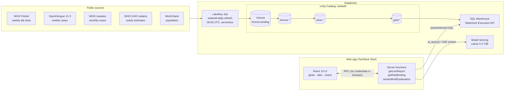
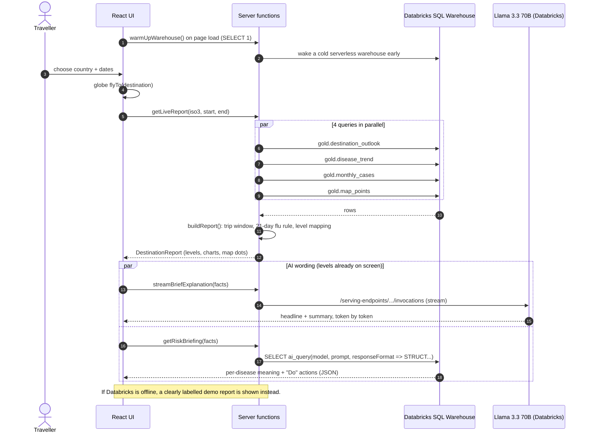
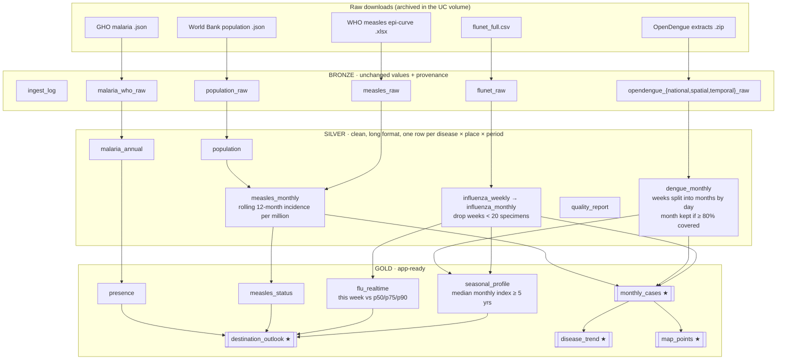
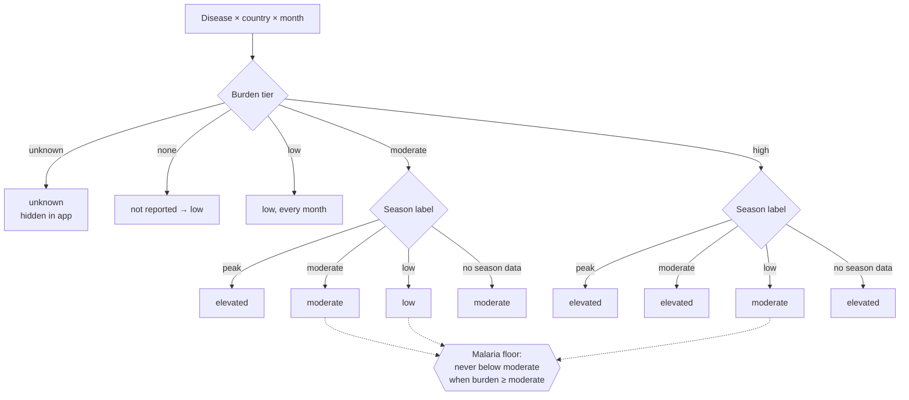
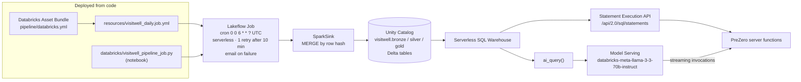
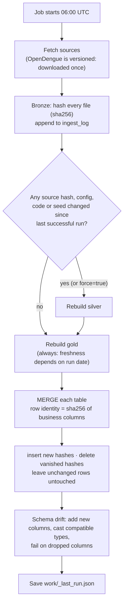
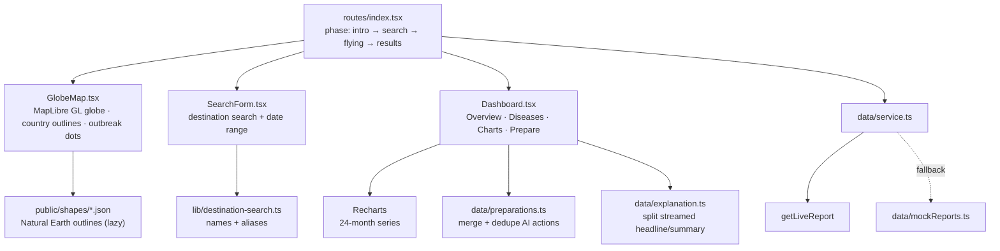
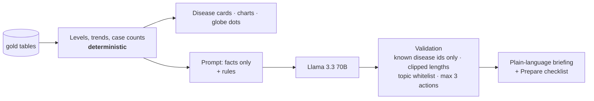
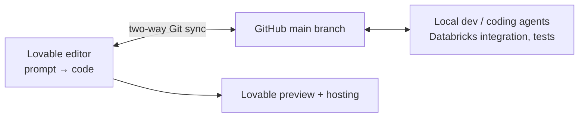

<p align="center">
  
</p>

<h1 align="center">PreZero</h1>

<p align="center"><b>Stop the outbreak before patient zero.</b><br/>
A travel health outlook for your exact destination and dates, built from public WHO data on Databricks.</p>

<p align="center">
  
  
  
  
</p>

> PreZero describes disease activity at a destination, not personal medical risk. It is not medical advice.
> Talk to a doctor or travel clinic before you travel.
---

explore here! -> https://p-rezero.health/

---

## Contents

1. [Why PreZero](#1-why-prezero)
2. [What it does](#2-what-it-does)
3. [Architecture at a glance](#3-architecture-at-a-glance)
4. [The data pipeline](#4-the-data-pipeline)
5. [How a level is decided](#5-how-a-level-is-decided)
6. [Databricks usage](#6-databricks-usage)
7. [The web app (backend + frontend)](#7-the-web-app-backend--frontend)
8. [AI: where it is used, and where it isn't](#8-ai-where-it-is-used-and-where-it-isnt)
9. [Lovable usage](#9-lovable-usage)
10. [Repository layout](#10-repository-layout)
11. [Running it locally](#11-running-it-locally)
12. [Testing](#12-testing)
13. [Limitations and roadmap](#13-limitations-and-roadmap)
14. [Data sources](#14-data-sources)

---

## 1. Why PreZero

Canada eliminated measles in 1998. In October 2024 an outbreak began with international travel to an event,
then spread through under-vaccinated communities. By November 2025, after more than 5,000 cases, Canada had lost
its measles-free status.

**Travel is the spark. Gaps in vaccination are the fuel.**

The people most likely to carry that spark are often families going home to visit relatives. They can face up to
4.5× the malaria risk of tourists, yet only about a quarter get pre-travel advice. The information exists, but it's
scattered across surveillance databases built for experts, and travel pages written for the whole year rather than
for *your* trip.

PreZero answers one family's real question: **what should we do before this trip, to this place, on these dates?**

## 2. What it does

You pick a country (by search or by clicking the globe) and your travel dates. PreZero flies the globe to the
destination and shows how four diseases are likely to look while you're there.

| Disease | Why it's here | Key action |
|---|---|---|
| **Measles** | The outbreak Canada is fighting now | Check for two MMR doses |
| **Influenza** | One of the most common vaccine-preventable illnesses in travellers | Get this season's flu shot |
| **Dengue** | Strong seasonal swings, so your dates matter | Prevent mosquito bites |
| **Malaria** | Highest risk for people visiting family | Ask a clinic about prevention pills |

The results come in four tabs:

| Tab | Content |
|---|---|
| **Overview** | A streamed plain-language briefing, plus the diseases that need attention |
| **Diseases** | Each disease's level (low / moderate / elevated), trend, source and latest month of data |
| **Charts** | The last 24 months of reported cases, so you can see the pattern yourself |
| **Prepare** | A merged checklist of vaccines to check, what to pack, and what to ask a travel clinic |

**Every level is computed from public data, not generated by AI.** AI only rewrites those facts into plain
language, and is told never to add numbers, change a level, or diagnose.

## 3. Architecture at a glance

PreZero has three layers: a daily **data pipeline on Databricks**, a small **serverless backend** (TanStack Start
server functions), and a **React frontend** that started life in **Lovable**.



Request flow when a traveller asks for a report:



## 4. The data pipeline

Our sources arrive in four different shapes (weekly lab positivity, weekly cases, monthly cases, yearly
estimates). A **medallion pipeline** (bronze → silver → gold) makes them comparable. The code lives in
[`pipeline/`](pipeline/) and is plain Python + pandas, so exactly the same functions run on a laptop and inside
Databricks.



★ = tables read by the web app.

### Bronze: keep the raw truth
[`ingest.py`](pipeline/visitwell_pipeline/ingest.py) downloads every source and stores values **unchanged** (as
strings). Every row carries `_source`, `_source_url`, `_file`, `_file_sha256` and `_retrieved_at`, and
`bronze.ingest_log` records one row per file per run. Because bronze is never modified, any cleaning rule can be
changed and everything rebuilt without downloading again.

### Silver: clean and drop what's too thin to trust
[`clean/`](pipeline/visitwell_pipeline/clean/) produces long-format tables with `source`, `data_as_of`,
`is_complete_year` and `low_sample_flag` on every row.

| Rule | Why |
|---|---|
| Flu weeks with **< 20 specimens** are flagged and excluded | Percent-positive from 3 tests is noise |
| **2020 and 2021** are excluded from every flu baseline | COVID lockdowns broke normal seasons |
| Dengue months are kept only if **≥ 80% of days** are covered by reports | A half-reported month looks like a drop |
| When several dengue extracts overlap, only the best-covered one is kept | No double counting |
| Unreported measles months stay **null, never 0** | Missing data must not look like safety |
| FluNet's column mapping is checked against the WHO data dictionary at runtime | Catch upstream schema changes |

### Gold: one vocabulary for every disease
[`gold/`](pipeline/visitwell_pipeline/gold/) reduces everything to the same two questions per country, disease and
month, across **~250 countries and territories**:

* **`seasonal_profile`** (flu, dengue): for each complete year, `index = month / that year's monthly mean`, then
  the median over at least 5 years. ≥ 1.5 = peak, 1.0–1.5 = moderate, < 1.0 = low. A consistency score records how
  often the month was in that year's top 3.
* **`flu_realtime`**: the latest valid week vs. the same ISO week in past years (p75 = higher than usual,
  p90 = much higher). Falls back to seasonal if the data is > 4 weeks old or there are < 5 baseline years.
* **`measles_status`**: 12-month incidence per million; becomes `unknown` if WHO's latest month is > 6 months old.
* **`destination_outlook`**: the final level per disease × month, with `based_on`, `data_as_of`, `source`,
  `source_url` and a JSON `details` column explaining the method.
* **`monthly_cases`**, **`disease_trend`**, **`map_points`**: 24-month chart series, a 3-vs-3-month trend, and
  dots for the globe (province-level for dengue where coordinates exist).

Every threshold lives in one file, [`config/pipeline.yaml`](pipeline/config/pipeline.yaml), and every
placeholder cut-off is marked `needs_review: true` for public-health experts.

For the full step-by-step reference see [`pipeline/README.md`](pipeline/README.md).

## 5. How a level is decided

Every level answers two separate questions:

* **Burden:** how much disease is there for the population? (absolute, yearly)
* **Season:** is your month usually busier than normal *there*? (relative, monthly)

A peak month in a country with almost no dengue is still low risk, so the two are measured separately and then
combined by one shared rule in [`gold/levels.py`](pipeline/visitwell_pipeline/gold/levels.py).



| Disease | Burden (unit) | Season | Level comes from |
|---|---|---|---|
| Dengue | Cases per 100,000 per year, averaged over 3–5 recent complete years | Yes | Burden × season |
| Influenza | Fixed at *moderate* (it circulates everywhere) | Yes | Season, or **live lab data for trips within 21 days** |
| Measles | Cases per million, past 12 months | No reliable season | Burden |
| Malaria | WHO cases per 1,000 at risk, latest year | No monthly data | Burden, never below moderate |

Burden tiers step up by roughly 10× because disease rates differ by hundreds of times between countries. For
measles, "low" means under 1 case per million, matching the WHO African Region's elimination incidence goal.

The frontend maps the pipeline's vocabularies onto four display levels
([`report-mapping.ts`](frontend/src/data/report-mapping.ts)):

| Display | Pipeline values |
|---|---|
| 🔴 **elevated** | peak · much_higher · high · outbreak · widespread |
| 🟠 **moderate** | moderate · higher_than_usual · circulating · present |
| 🟢 **low** | low · typical · not_reported · some_areas |
| ⚪ **unknown** | everything else; the disease is **left out** rather than shown as low |

For a trip spanning several months, a disease's level is the **highest** level across the months in the window.

## 6. Databricks usage

Databricks is the backbone of PreZero: storage, scheduling, compute, SQL serving, and the LLM all run there.



| Feature | How PreZero uses it |
|---|---|
| **Unity Catalog** | Catalog `visitwell` with schemas `bronze`, `silver`, `gold`, plus volume `/Volumes/visitwell/bronze/landing/` that archives every raw download and its `_manifest.json` |
| **Delta Lake** | All ~25 tables are Delta. `DESCRIBE HISTORY visitwell.gold.destination_outlook` shows each day's `MERGE` |
| **Lakeflow Jobs** | `visitwell-daily-refresh` runs the pipeline notebook every day at 06:00 UTC on serverless job compute, with retries, a 1-hour timeout and failure emails |
| **Asset Bundles** | The job, notebook and code are deployed with `databricks bundle deploy`, no clicking in the UI |
| **Serverless SQL Warehouse** | Serves the gold tables to the app through the Statement Execution REST API (plain `fetch`, works on edge runtimes) |
| **`ai_query()`** | Generates the structured per-disease briefing as typed JSON (`responseFormat => STRUCT<...>`) from SQL |
| **Model Serving** | Llama 3.3 70B foundation model endpoint, streamed over server-sent events for the Overview headline |

### Incremental daily runs

The job doesn't rebuild blindly:



There are two ways to write to Databricks:

* **From a laptop**: `python dt_preproc.py --sink databricks` stages each table as parquet in the volume, then runs
  `CREATE OR REPLACE TABLE … AS SELECT * FROM read_files(...)` on the SQL warehouse (`DatabricksSqlSink`).
* **Inside Databricks** (the scheduled job): the notebook uses `SparkSink`, which MERGEs into existing tables.

## 7. The web app (backend + frontend)

The app lives in [`frontend/`](frontend/). It is a single **TanStack Start** project: React on the client, and
**server functions** (`createServerFn`) that only ever execute on the server. There is no separate API service.

### Backend: server functions

| Function | File | What it does |
|---|---|---|
| `getLiveReport` | [`report.functions.ts`](frontend/src/data/report.functions.ts) | Validates input (ISO3, dates), runs 4 parameterized queries on the gold tables in parallel, then `buildReport()` |
| `warmUpWarehouse` | same | `SELECT 1` on page load, so a cold serverless warehouse is awake by the time the user submits |
| `streamBriefExplanation` | [`briefing.functions.ts`](frontend/src/data/briefing.functions.ts) | Streams the Overview headline + summary from the model serving endpoint |
| `getRiskBriefing` | same | Calls `ai_query()` for per-disease meaning + "Do" actions as validated JSON |

[`databricks.server.ts`](frontend/src/server/databricks.server.ts) is a small client with no dependencies: it
submits a statement, polls while the warehouse is `PENDING/RUNNING`, converts typed columns, and parses SSE chunks
for streaming chat.

**Security:** `DATABRICKS_*` variables have no `VITE_` prefix, so they are never bundled into the browser. All
SQL uses named parameters (`:iso`), never string interpolation of user input.

**Resilience:** [`service.ts`](frontend/src/data/service.ts) is the only entry point components use. If the live
call fails and a demo dataset exists for that destination, the demo is returned with `isDemo: true` and the UI
labels it. If the AI calls fail, the levels still show.

### Frontend



| Layer | Tech |
|---|---|
| Framework | TanStack Start + TanStack Router (file-based routes), React 19, TypeScript |
| Styling | Tailwind CSS v4, shadcn/ui (Radix primitives), lucide icons |
| Globe | MapLibre GL in globe projection with custom layers; an experimental Three.js glass Earth (`GlassEarth.tsx`) is kept separately |
| Charts | Recharts |
| Build | Vite 8 via `@lovable.dev/vite-tanstack-config`, Nitro server output (Cloudflare Worker target by default) |
| Tests | Vitest + Testing Library + jsdom |

The destination list ([`destinations.generated.ts`](frontend/src/data/destinations.generated.ts)) and the
per-country outlines in `public/shapes/` are **generated by the pipeline** (`build_geo.py frontend`), so the app
only offers countries that have at least one known disease level.

## 8. AI: where it is used, and where it isn't



The model is a **translator, not a decision-maker**:

* Levels are computed in the pipeline and rendered straight from the tables.
* The prompt contains only the computed facts, and forbids inventing numbers, dates, regions or diseases,
  changing any level, or diagnosing. It must point to a doctor or travel clinic for vaccines and medication.
* Output is validated server-side: unknown disease ids are dropped, strings are clipped, action topics are
  restricted to a fixed list, and the Prepare tab merges duplicate advice across diseases (max 6 items).
* If the model is unavailable, the report still works without the wording.

## 9. Lovable usage

The frontend was **generated with [Lovable](https://lovable.dev)** and then extended by hand and with coding
agents. The repo is still connected to the Lovable project, so changes sync both ways.



What Lovable gave us:

* **Scaffold:** the `tanstack_start_ts_current` template (`frontend/.lovable/project.json`) with TanStack Start,
  Tailwind, shadcn/ui, the Vite config (`@lovable.dev/vite-tanstack-config`), and error reporting.
* **UI iterations by prompt:** the landing page, globe styling (illustrated → luminous → glass Earth experiments),
  the dashboard, disease cards, globe markers with popups and legend, Recharts charts, and the printable
  preparation checklist. These are tracked in [`frontend/roadmap.md`](frontend/roadmap.md).
* **Product framing:** a north-star statement and metric in
  [`frontend/.lovable/north-star/north-star.md`](frontend/.lovable/north-star/north-star.md):
  *"Travellers arrive at their destination protected against the local health risks."*
* **Hosted assets:** Earth textures and models referenced through `src/assets/*.asset.json`.

What we built on top: the Databricks client and server functions, report mapping, AI briefing + streaming, the
Prepare merge logic, search, the globe interactions, and all tests.

Ground rules for working in a Lovable-connected repo (from [`frontend/AGENTS.md`](frontend/AGENTS.md)):
don't force-push or rewrite pushed history, don't hand-edit generated files (e.g. `routeTree.gen.ts`), and keep
secrets out of the repo.

## 10. Repository layout

```
hackcamp2026/
├── README.md                     ← you are here
├── .env.example                  DATABRICKS_HOST / TOKEN / HTTP_PATH (shared by pipeline + app)
├── docs/DEVPOST.md               hackathon submission write-up
│
├── pipeline/                     Python data pipeline (runs locally and on Databricks)
│   ├── config/pipeline.yaml      every source URL, threshold and cut-off
│   ├── dt_preproc.py             CLI entry point
│   ├── build_geo.py              Natural Earth → map centroids + frontend destinations/shapes
│   ├── databricks.yml            Databricks Asset Bundle
│   ├── resources/                Lakeflow Job definition
│   ├── databricks/               notebook run by the job
│   ├── visitwell_pipeline/
│   │   ├── ingest.py             bronze
│   │   ├── clean/                silver (influenza, dengue, measles, malaria, population)
│   │   ├── gold/                 seasonal, flu_realtime, measles_status, levels, outlook, app_tables
│   │   ├── quality.py            data quality report
│   │   ├── sinks.py              Local / DatabricksSql / Spark (MERGE) sinks
│   │   ├── run.py                orchestrator (full + incremental)
│   │   └── api.py                get_outlook() for ad-hoc queries
│   └── tests/                    pytest, synthetic data, no network
│
└── frontend/                     TanStack Start app (Lovable project)
    ├── src/routes/               index.tsx (page), __root.tsx
    ├── src/components/           GlobeMap, Dashboard, SearchForm, GlassEarth
    ├── src/data/                 server functions, report mapping, briefing, preparations, types
    ├── src/server/               databricks.server.ts (SQL + streaming chat client)
    ├── src/lib/                  search, globe layers/styles, world grid
    └── public/                   country shapes, world outline, Earth assets
```

> The pipeline package is called `visitwell_pipeline` and the Databricks catalog `visitwell`: VisitWell was
> the project's working name before it became PreZero.

## 11. Running it locally

### Prerequisites
* Python 3.11+, Node.js 20+
* A Databricks workspace with a SQL warehouse (optional: the app falls back to demo data without it)

### Credentials
```bash
cp .env.example .env
# DATABRICKS_HOST=https://<workspace>.cloud.databricks.com
# DATABRICKS_TOKEN=<personal access token>
# DATABRICKS_HTTP_PATH=/sql/1.0/warehouses/<id>
```

### Pipeline
```bash
cd pipeline
python -m venv .venv && source .venv/bin/activate
pip install -r requirements.txt

python dt_preproc.py                                   # bronze → silver → gold, local parquet in data/
python dt_preproc.py --sink databricks                 # same + Delta tables in Unity Catalog
python dt_preproc.py outlook VNM 2027-01-25 2027-02-20 # ad-hoc outlook for a Tet trip
python -m pytest                                       # offline tests
```

Deploy the daily job:
```bash
databricks auth login --host $DATABRICKS_HOST
databricks bundle validate && databricks bundle deploy
databricks bundle run visitwell_daily                  # optional: run now
```

Refresh the app's destination list and country outlines after a gold rebuild:
```bash
python build_geo.py centroids   # after silver
python build_geo.py frontend    # after gold → frontend/src/data/destinations.generated.ts + public/shapes/
```

### Web app
```bash
cd frontend
npm install
npm run dev        # reads DATABRICKS_* from the repo-root .env into the dev server only
npm test           # vitest
npm run build      # production build
```

In production, set `DATABRICKS_HOST`, `DATABRICKS_TOKEN` and `DATABRICKS_HTTP_PATH` (or
`DATABRICKS_WAREHOUSE_ID`) as server-side secrets on the host.

## 12. Testing

| Suite | Count | Covers |
|---|---|---|
| **pytest** (`pipeline/tests/`) | 77 tests | seasonal index and labels, insufficient and excluded years, consistency, flu percentile boundaries and freshness fallback, the 21-day switch, measles thresholds/staleness/alert override, burden × season matrix and malaria floor, missing data → unknown, week-to-month splitting, FluNet dictionary check, MERGE planning and schema drift, app tables |
| **Vitest** (`frontend/src/`) | ~36 tests | row → UI report mapping, level vocabulary, Prepare merge/dedupe rules, streamed explanation parsing, destination search, globe grid/surface helpers, app routing |

All pipeline tests use synthetic fixtures and make no network calls.

## 13. Limitations and roadmap

**Known limitations**
* OpenDengue V1.3 runs to about early 2025, so dengue is presented as a **seasonal outlook**, not a live count.
* Malaria is yearly and national only (Malaria Atlas Project admin-1 data is supported but needs a manual export).
* Hepatitis A, typhoid and yellow fever have no country-by-month source, so they are left out rather than guessed.
* Some countries show `unknown` for a disease (e.g. India's dengue has too few complete years; stale measles
  reports become unknown after 6 months).
* All cut-offs are starting values flagged `needs_review` in the config.

**What's next**
* Pilot with one travel clinic and one community organization before Lunar New Year travel, with a public-health
  partner reviewing cut-offs.
* Chikungunya and Zika from PAHO data; hepatitis A and typhoid as year-round reminders.
* Province-level burden (province-level dengue seasons are already in the tables).
* Official outbreak alerts for every disease (the measles `outbreak` override is already wired).
* Community languages: Vietnamese, Chinese, Punjabi, Tagalog and more.
* Clinic hand-off and an after-trip check-in: "if you get a fever, tell your doctor where you travelled."

## 14. Data sources

| Source | Used for | Cadence |
|---|---|---|
| [WHO FluNet](https://www.who.int/tools/flunet) | Influenza lab positivity (seasonal + real-time) | Weekly |
| [OpenDengue V1.3](https://opendengue.org/) | Dengue cases, national and admin-1 | Versioned release |
| [WHO provisional measles and rubella data](https://immunizationdata.who.int/global?topic=Provisional-measles-and-rubella-data&location=) | Measles monthly cases | Monthly |
| [WHO Global Health Observatory](https://www.who.int/data/gho) `MALARIA_EST_INCIDENCE` | Malaria burden | Yearly |
| [World Bank WDI](https://data.worldbank.org/indicator/SP.POP.TOTL) `SP.POP.TOTL` | Population denominators | Yearly |
| [Natural Earth](https://www.naturalearthdata.com/) | Country outlines and map label points | Static |

Every gold row keeps its source, data date, and the SHA-256 hash of the exact file it came from.

---

<p align="center">Built at HackCamp 2026 · see <a href="docs/DEVPOST.md">docs/DEVPOST.md</a> for the submission write-up.</p>
